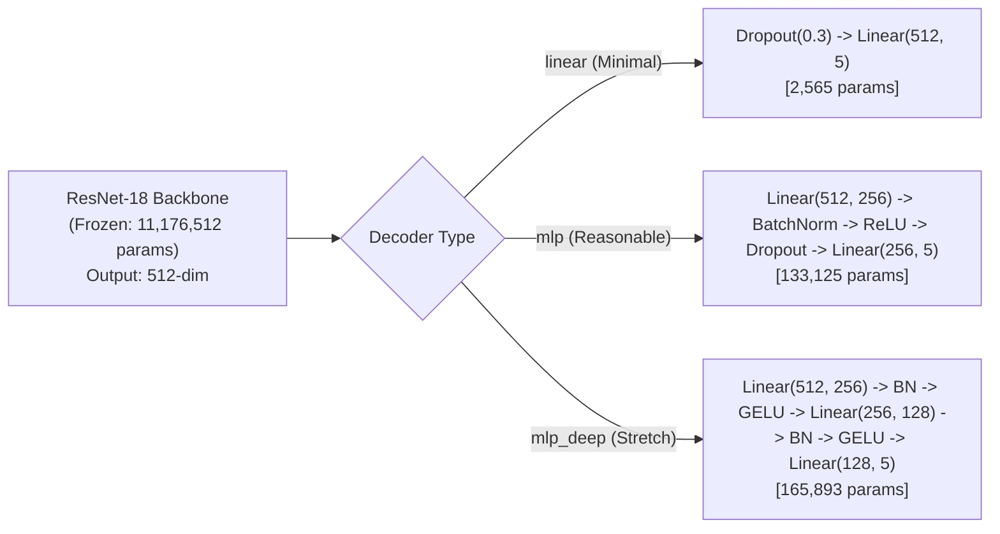

# DeFungi ResNet-18 Transfer Learning — Team Runbook & Execution Guide

This document provides complete instructions for setting up the environment, running the ResNet-18 transfer learning pipeline on the **DeFungi** microscopic image dataset, managing checkpoints across training sessions, and generating benchmark evaluation figures.

All commands and file paths in this guide are **generic and portable** across different machines and operating systems.

---

## 1. Project Overview & Milestones

The goal of this project is to classify fungal microscopic morphotypes across 5 classes (`H1`, `H2`, `H3`, `H5`, `H6`) using transfer learning.

| Project Milestone | Due Date | Target Threshold | ResNet-18 Status |
|---|---|---|---|
| **Majority Baseline (Zero-R)** | — | 48.33% Accuracy / 13.03% Macro F1 | Baseline from `Baseline.ipynb` |
| **Minimum Requirement** | Oct 30 | Beat majority baseline, select pre-trained model, replace decoder head | **Achieved (63.96% Acc / 64.93% F1)** |
| **Reasonable Goal** | Nov 6 | >10% over baseline (>58.33% Acc / >23.03% F1), train & validate decoder | **Achieved (+15.63% Acc / +51.90% F1)** |
| **Stretch Goal** | Nov 13 | >20% over minimum requirement (>68.33% Acc), fine-tune full backbone | Supported via `unfreeze_backbone()` |

---

## 2. Directory Structure

The transfer learning module is self-contained in `src/transfer/`:

```text
MA416Project/
├── defungi/                       # Dataset folder containing subfolders H1, H2, H3, H5, H6
├── src/
│   ├── baseline/
│   │   └── Baseline.ipynb        # Course baseline notebook
│   └── transfer/
│       ├── __init__.py           # Package marker
│       ├── dataset.py            # Stratified 80/20 data split, transforms, DataLoader setup
│       ├── model.py              # ResNet-18 backbone + customizable decoder heads (linear, mlp, mlp_deep)
│       └── train.py              # Full training, validation, checkpointing, and evaluation script
├── checkpoints/                  # Saved .pt model checkpoints (created automatically)
├── plots/                        # Saved curves and confusion matrices (created automatically)
├── pyproject.toml                # Portable interpreter & type checker configuration
└── pyrefly.toml                  # Standalone IDE type checker configuration
```

---

## 3. Environment Setup & Prerequisites

### Required Packages
- **Python**: 3.10 – 3.12 (Python 3.12 recommended)
- **PyTorch & torchvision**: GPU-accelerated (CUDA) or CPU fallback
- **Data & Evaluation**: `scikit-learn`, `pandas`, `pillow`, `matplotlib`, `numpy`, `tqdm`

### Activating the Virtual Environment

Before running any script, activate your virtual environment in your terminal:

#### Windows (PowerShell):
```powershell
# If using a local .venv in the project root:
.\.venv\Scripts\Activate.ps1

# Or if using a shared course environment elsewhere:
& "<path-to-your-venv>\Scripts\Activate.ps1"
```

#### Windows (Command Prompt):
```cmd
.venv\Scripts\activate.bat
```

#### macOS / Linux:
```bash
source .venv/bin/activate
```

*(Once activated, your terminal prompt will show `(.venv)`, and standard `python` commands will invoke the correct environment on all operating systems.)*

---

## 4. How to Run the Training Pipeline

### Quick Start (Standard Baseline Training)
Train ResNet-18 with a linear decoder head for 10 epochs using a batch size of 32:

```bash
python src/transfer/train.py --epochs 10 --batch-size 32
```

> [!NOTE]
> The script automatically detects an NVIDIA GPU if available; otherwise, it seamlessly falls back to CPU.

---

### Command-Line Arguments & Modifiable Paths

All directories and parameters can be overridden via CLI flags to match any teammate's file structure:

| Argument | Type | Default | Description |
|---|---|---|---|
| `--epochs` | `int` | `10` | Total number of epochs to train. |
| `--batch-size` | `int` | `32` | Batch size for training and validation DataLoaders. |
| `--lr` | `float` | `0.001` | Learning rate for the trainable decoder head. |
| `--dropout` | `float` | `0.3` | Dropout probability applied before classification. |
| `--decoder-type` | `str` | `linear` | Head architecture: `linear`, `mlp`, or `mlp_deep`. |
| `--scheduler` | `str` | `cosine` | LR schedule: `cosine`, `plateau`, or `none`. |
| `--weight-decay` | `float` | `1e-4` | L2 weight decay for the Adam optimizer. |
| `--num-workers` | `int` | `2` | Number of DataLoader worker processes (`0` for Windows debugging). |
| `--no-class-weights`| `flag` | `False` | Disables inverse-frequency weighting in CrossEntropyLoss. |
| `--resume` | `str` | `None` | Path to a `.pt` checkpoint file to resume training from. |
| `--dataset-dir` | `str` | `None` | Custom path to the `defungi/` directory if stored outside root. |
| `--checkpoint-dir`| `str` | `checkpoints` | Custom target folder for saved model weights. |
| `--plots-dir` | `str` | `plots` | Custom target folder for evaluation charts and confusion matrices. |

#### Example: Specifying Custom Paths
If your dataset is located in another folder or drive:
```bash
python src/transfer/train.py --dataset-dir "../shared_data/defungi" --checkpoint-dir "./my_checkpoints" --plots-dir "./my_plots"
```

---

## 5. Experimenting with Different Decoder Heads

Three distinct decoder architectures are built into `model.py` to compare representation capacity:



### Commands to Compare Heads:

1. **Linear Projection Head (Minimal Requirement)**:
   ```bash
   python src/transfer/train.py --decoder-type linear --epochs 10
   ```
2. **2-Layer MLP Head with BatchNorm (Reasonable Goal)**:
   ```bash
   python src/transfer/train.py --decoder-type mlp --epochs 10 --lr 0.0005
   ```
3. **3-Layer Deep MLP Head with GELU (Stretch Goal Candidate)**:
   ```bash
   python src/transfer/train.py --decoder-type mlp_deep --epochs 10 --lr 0.0003
   ```

---

## 6. Checkpoint Management & Multi-Session Training

You do not need to run all epochs in a single continuous session. The pipeline automatically maintains two checkpoints:
1. **`checkpoints/resnet18_<decoder>_best.pt`**: Updated whenever validation Macro-F1 improves.
2. **`checkpoints/resnet18_<decoder>_latest.pt`**: Updated at the end of **every** epoch.

### How to Stop & Resume Training Later

#### Step 1: Run First Session (e.g., 5 Epochs)
```bash
python src/transfer/train.py --epochs 5 --decoder-type linear
```

#### Step 2: Resume in a Later Session (e.g., 5 More Epochs)
Pass the `--resume` flag pointing to the checkpoint:
```bash
python src/transfer/train.py --epochs 5 --decoder-type linear --resume checkpoints/resnet18_linear_latest.pt
```

The script will automatically:
- Load model weights and classification head parameters.
- Restore the Adam optimizer state and momentum buffers.
- Resume epoch counter sequentially (e.g., Epoch 6 to 10).
- Preserve the previous highest Macro-F1 for saving new best models.

---

## 7. Output Artifacts & Results Inspection

Upon completion, `train.py` automatically generates:

1. **Terminal Benchmark Summary**:
   - Classification report (precision, recall, F1 per class).
   - Side-by-side comparison table against the Majority Class Baseline.
2. **Loss & Accuracy Curves (`plots/resnet18_<decoder>_training_curves.png`)**:
   - Subplot 1: Train Loss vs. Validation Loss across epochs.
   - Subplot 2: Train Accuracy vs. Validation Accuracy with the 48.33% majority baseline line.
3. **Confusion Matrix Plot (`plots/resnet18_<decoder>_confusion_matrix.png`)**:
   - Visual heatmap displaying true labels vs. predicted labels for all 1,823 test images.

---

## 8. IDE & Language Server Configuration (Optional)

If teammates see import warnings (`torchvision`, `torch`) in their editor:

1. Ensure the Python interpreter in their IDE is set to their active virtual environment.
2. The project contains a generic [`pyproject.toml`](file:///c:/Users/novojiac/gitOrganized/MA416Project/pyproject.toml) where the interpreter path can be customized:
   ```toml
   [tool.pyrefly]
   # Adjust to point to your local virtualenv if not in .venv
   python-interpreter-path = ".venv/Scripts/python.exe"
   search-path = ["src", "src/transfer"]
   ```
3. In VS Code or Antigravity IDE, press `Ctrl + Shift + P` and select **`Developer: Reload Window`** to refresh diagnostics.

---

## 9. Troubleshooting FAQ

> [!TIP]
> **Issue: Out of Memory (CUDA OOM)**
> - Reduce `--batch-size` from `32` to `16` or `8`.
> - Add `--num-workers 0` if GPU shared memory is constrained.

> [!IMPORTANT]
> **Issue: Cannot find `defungi` directory**
> - The script automatically searches for a `defungi` folder in the current directory and parent directories.
> - If stored elsewhere, provide the explicit relative or absolute path via `--dataset-dir <path>`.
